# 클래스 관리

> **클래스는 학생을 그룹으로 관리하는 기본 단위**입니다.
>
> 필요에 따라 별도의 클래스를 생성해 학생을 그룹으로 나누고,\
> 각 그룹에 맞춰 수업이나 과제를 관리할 수 있습니다.

### 영상 보며 따라하기



### 클래스 구분이 필요한 이유

다음과 같은 경우에도 편리하게 학습을 관리할 수 있습니다.

* 학생을 수준이나 반별로 구분하고 싶을 때
* 수업이나 과제를 그룹별로 따로 운영하고 싶을 때
* 클래스별 리포트를 따로 보고 싶을 때


**기본반이란?**

* 회원가입 시 자동으로 생성되는 기본 클래스입니다.
* 학생의 동일한 이름으로 표시되며, 등록된 모든 학생은 이 클래스에 포함됩니다.
* 기본반은 삭제는 불가능하며, 이름만 수정할 수 있습니다.


***

## 1. 클래스 화면 열기



좌측 사이드바에서 **\[클래스]** 를 클릭합니다.

<figure>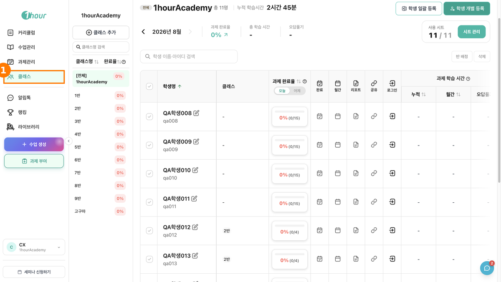<figcaption></figcaption></figure>



왼쪽 클래스 목록에서 작업할 클래스를 선택합니다.

목록 맨 위의 **\[전체]** 는 학원 전체 학생을 한 번에 보는 상태입니다. 클래스별 기능을 쓰려면 개별 클래스를 선택해야 합니다.

<figure>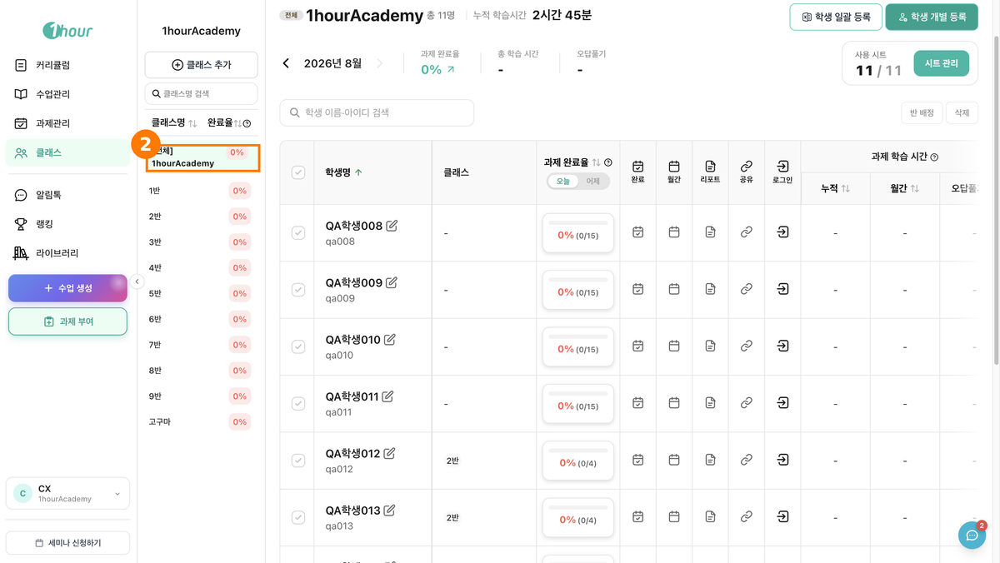<figcaption></figcaption></figure>



***

## 2. 클래스 만들기



왼쪽 클래스 목록 위의 **\[⊕ 클래스 추가]** 를 클릭합니다.

<figure>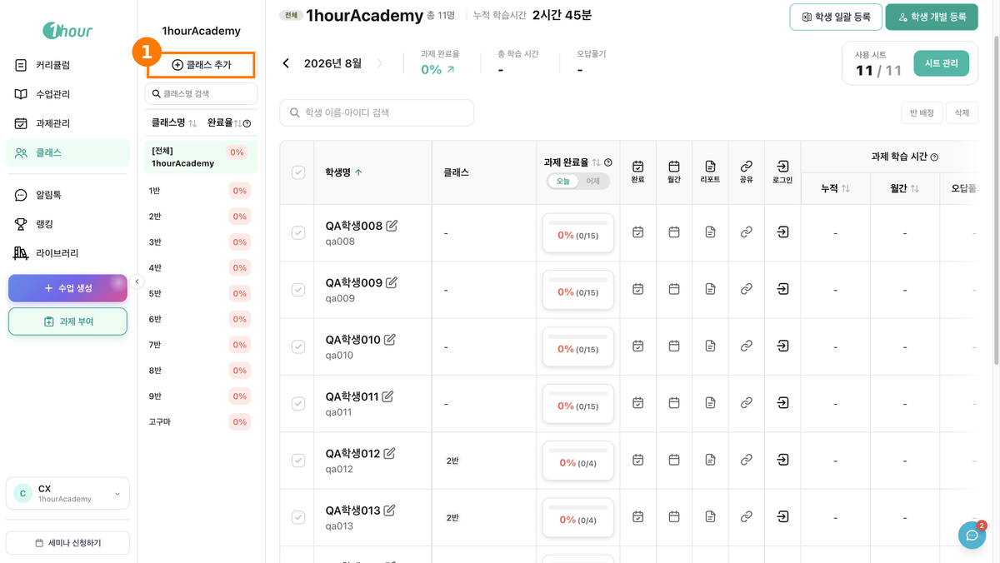<figcaption></figcaption></figure>




클래스명은 만든 뒤에도 바꿀 수 있습니다. 개별 클래스를 선택하면 클래스명 옆에 수정 아이콘이 나타납니다.


***

## 3. 클래스에 학생 등록하기


학생 등록에는 시트가 필요합니다. 빈 시트가 없으면 등록 창에 `빈 시트가 없어 학생 추가 시 시트 결제가 필요해요.` 안내가 표시됩니다. 시트는 우측 상단 `[시트 관리]` 에서 확인합니다.


### 방법 1. 엑셀로 한 번에 등록하기

한 번에 최대 500명까지 등록할 수 있습니다.



왼쪽 클래스 목록에서 학생을 등록할 클래스를 선택합니다.

<figure>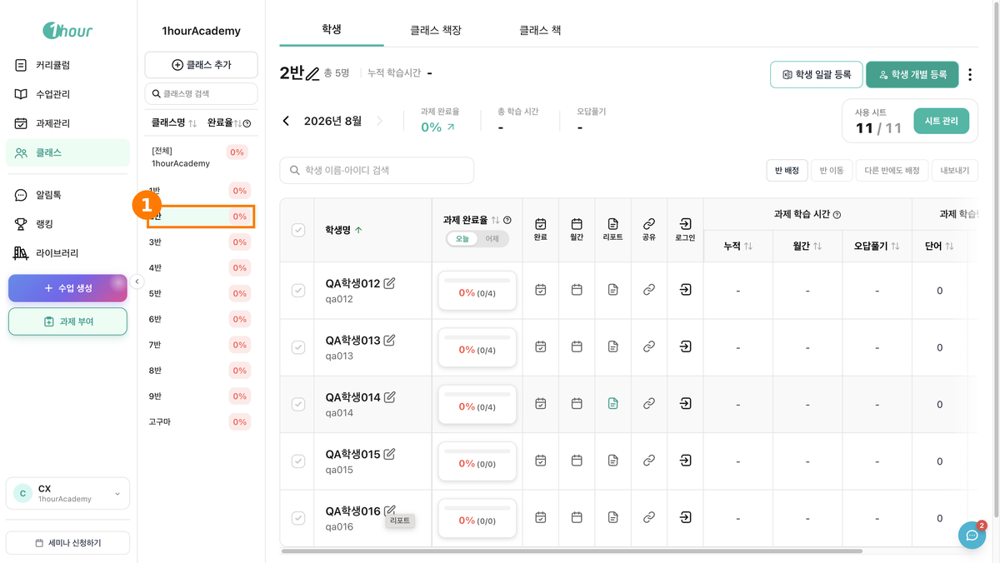<figcaption></figcaption></figure>



우측 상단 **\[학생 일괄 등록]** 을 클릭합니다.

<figure>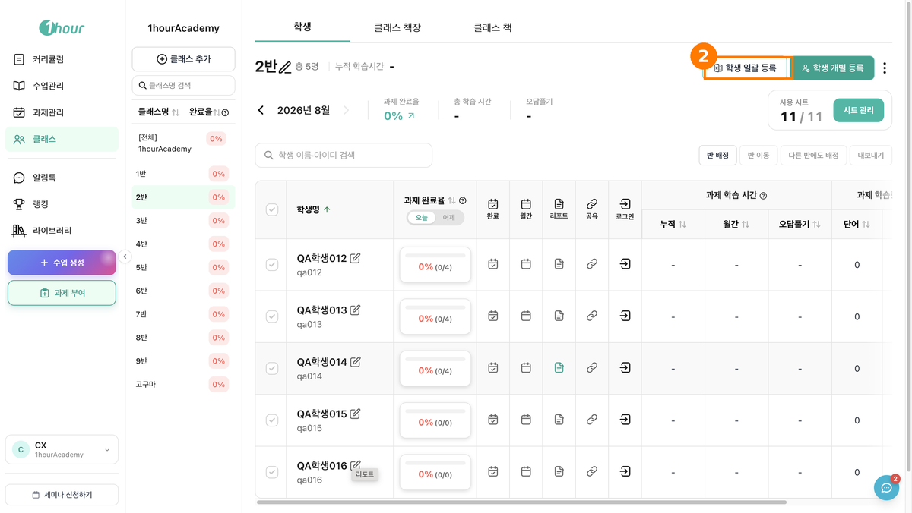<figcaption></figcaption></figure>



「엑셀 파일로 학생 일괄 추가하기 (최대 500명)」 창에서 **\[엑셀 파일 양식 다운로드]** 를 클릭합니다.

* 양식에는 `학생이름` `ID` `PW` `클래스명` 네 항목이 모두 필수입니다.&#x20;
* `ID`는 한글·영어·숫자를 쓸 수 있고 중복될 수 없습니다.&#x20;
* `PW`는 영어·숫자로 최소 4자리입니다. `클래스명`은 실제 클래스명과 똑같이 입력해야 합니다.

<figure>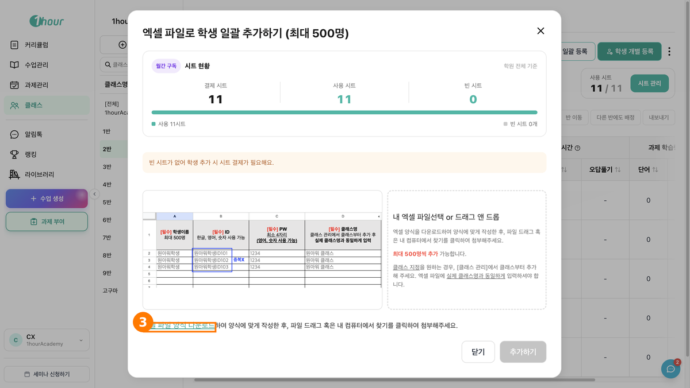<figcaption></figcaption></figure>



작성한 파일을 드래그하거나 `내 엑셀 파일선택` 으로 첨부한 뒤 `[추가하기]` 를 클릭합니다.



### 방법 2. 한 명씩 등록하기



우측 상단 **\[학생 개별 등록]** 을 클릭합니다.

<figure>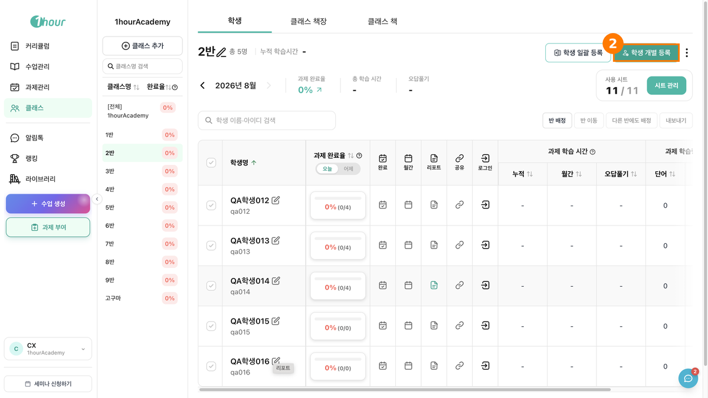<figcaption></figcaption></figure>



「학생 추가」 창에서 `아이디` `이름` `비밀번호` `비밀번호 확인` 을 입력하고 **\[추가]** 를 클릭합니다.

`학생이 소속되는 클래스 목록` 에 이 학생이 들어갈 클래스가 표시됩니다.

<figure>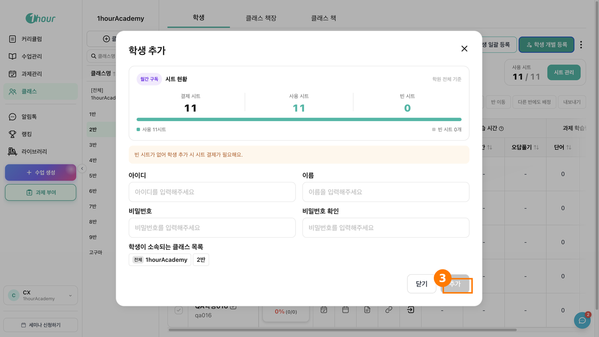<figcaption></figcaption></figure>




***

## 4. 학생을 다른 클래스로 옮기기

`[반 이동]` 과 `[다른 반에도 배정]` 은 개별 클래스를 선택했을 때만 나타납니다. `[전체]` 상태에서는 보이지 않습니다.

### 방법 1. 반 이동



옮길 학생을 체크한 뒤 검색창 우측 **\[반 이동]** 을 클릭합니다.

체크하면 버튼 왼쪽에 `N 명 선택됨` 이 표시됩니다.

<figure>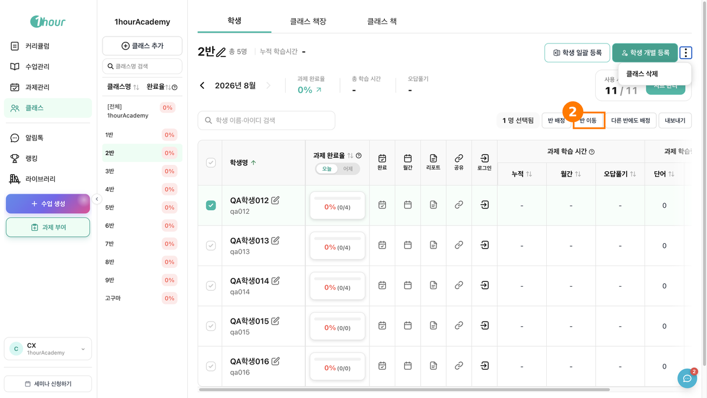<figcaption></figcaption></figure>



「학생 이동」 창에서 `배정할 반 선택` 목록의 반을 체크하고 **\[이동]** 을 클릭합니다.

현재 학생이 속한 클래스는 목록에 나오지 않습니다.

<figure>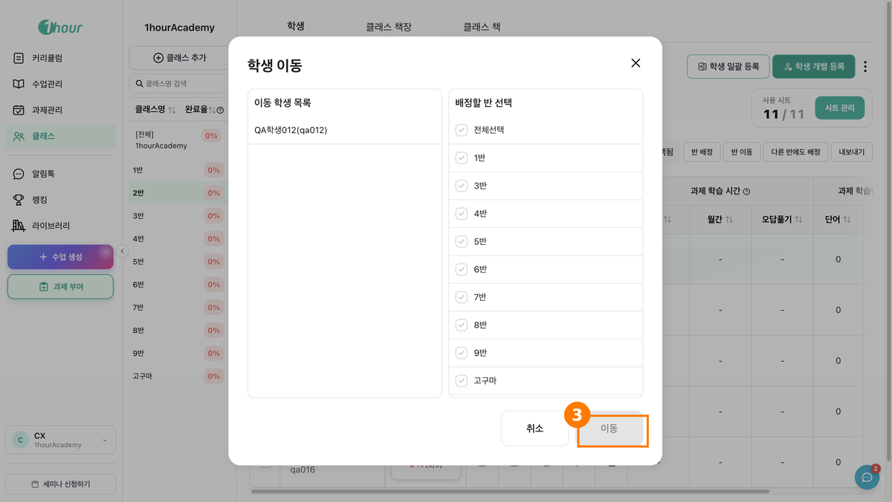<figcaption></figcaption></figure>



### 방법 2. 다른 반에도 배정



배정할 학생을 체크한 뒤 검색창 우측 **\[다른 반에도 배정]** 을 클릭합니다.

<figure>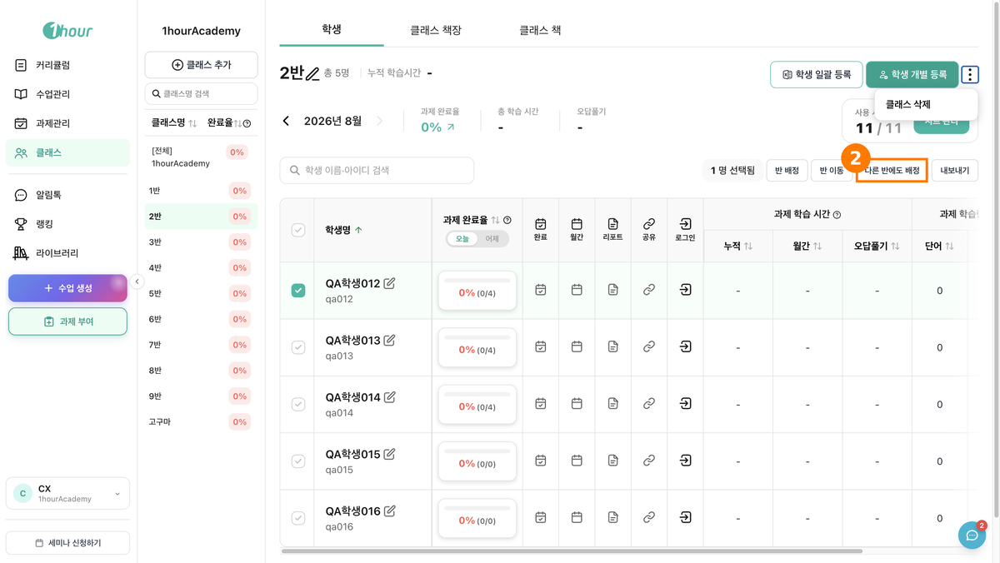<figcaption></figcaption></figure>



「학생 배정」 창에서 `배정할 반 선택` 목록의 반을 체크하고 **\[배정]** 을 클릭합니다.

<figure><figcaption></figcaption></figure>



***

## 5. 클래스에서 학생 내보내기



내보낼 학생을 체크한 뒤 검색창 우측 **\[내보내기]** 를 클릭합니다.

<figure><figcaption></figcaption></figure>



안내를 확인하고 **\[클래스에서 내보내기]** 를 클릭합니다.

<figure><figcaption></figcaption></figure>




내보내기는 이 클래스에서만 제외하는 기능입니다. 학생 계정과 학습 데이터, 이미 부여한 과제는 그대로 유지됩니다.

계정을 완전히 삭제하려면 왼쪽 목록에서 `[전체]` 를 선택한 뒤 검색창 우측 `[삭제]` 로 진행합니다.


***

## 6. 클래스 삭제하기



왼쪽 클래스 목록에서 삭제할 클래스를 선택한 뒤 우측 상단 **\[⋮]** 를 클릭합니다.

`[⋮]` 는 개별 클래스를 선택했을 때만 나타납니다. `[전체]` 가 선택된 상태에서는 표시되지 않습니다.

<figure>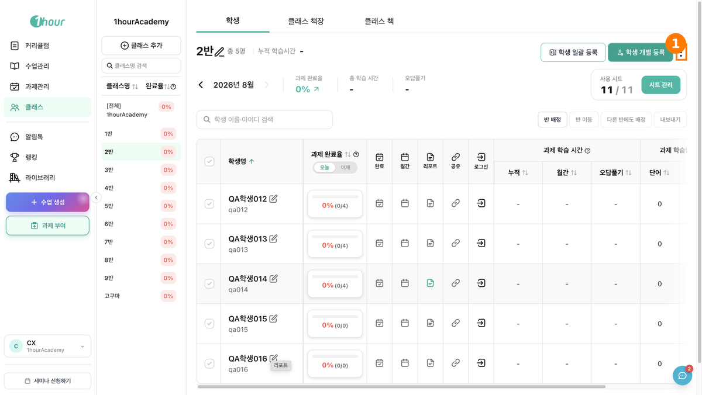<figcaption></figcaption></figure>



**\[클래스 삭제]** 를 클릭합니다.

<figure>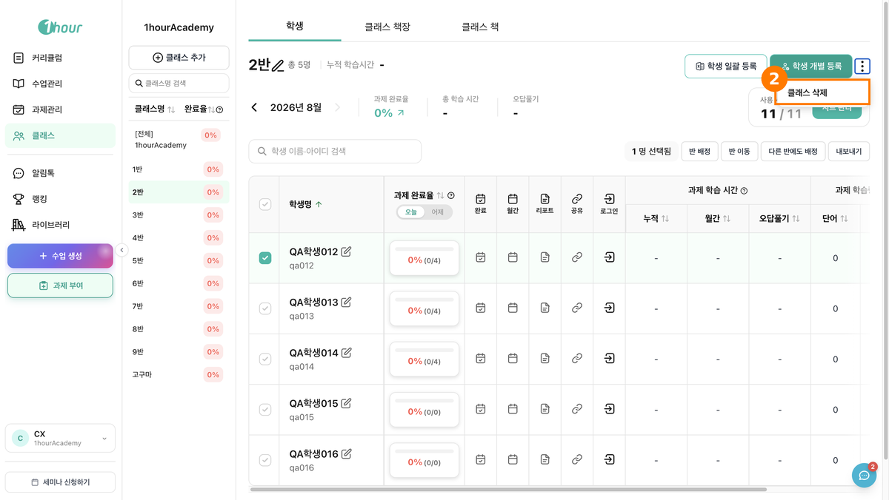<figcaption></figcaption></figure>



안내를 확인하고 **\[확인]** 을 클릭합니다.

<figure>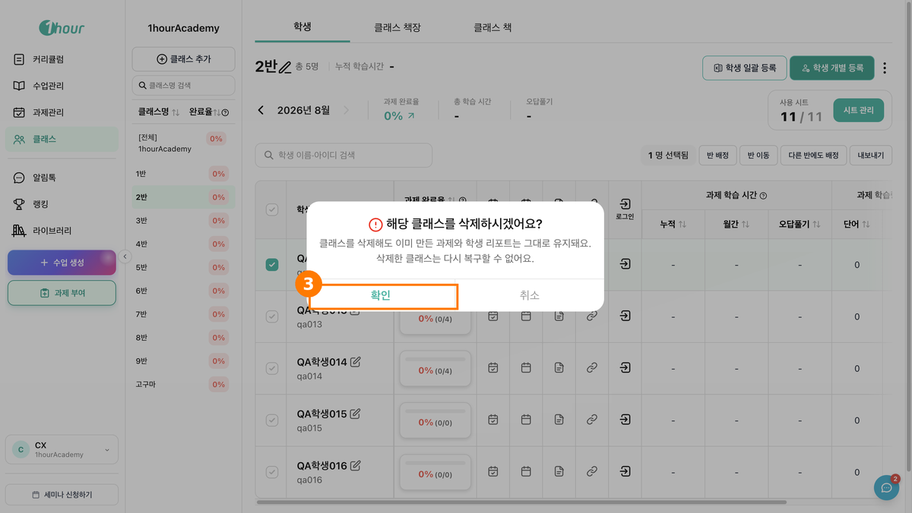<figcaption></figcaption></figure>




클래스를 삭제해도 이미 만든 과제와 학생 리포트는 유지됩니다. 다만 **삭제한 클래스는 복구할 수 없습니다.**


***

## 클래스별 학습 현황 보기

학생별 학습 데이터와 랭킹은 다른 메뉴에서 확인합니다.

* 랭킹 → 좌측 사이드바 **\[랭킹]**
* 학생별 리포트 → 좌측 사이드바 **\[과제관리]** > `[일별 리포트]` 탭 · `[월간 인사이트]` 탭
